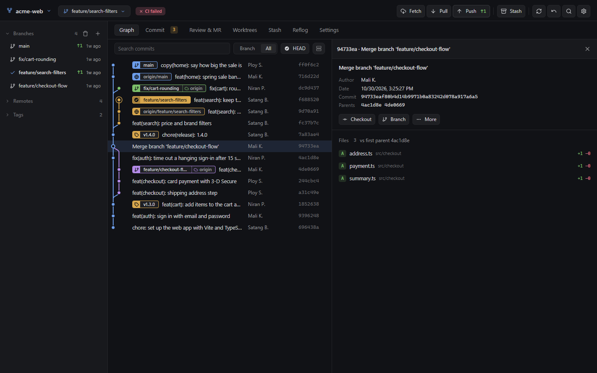
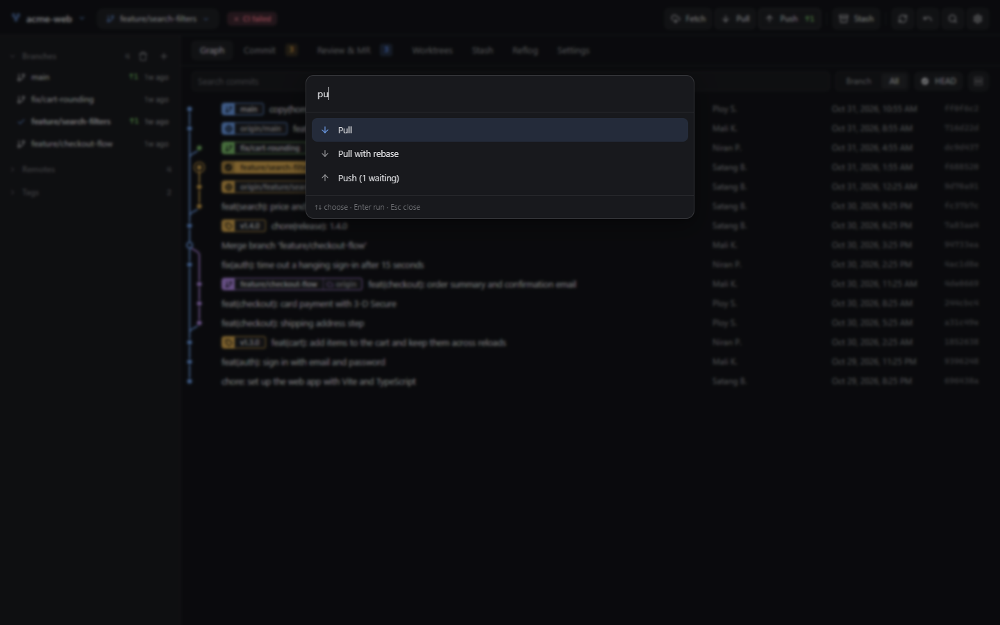

# Git Control for Orca

A Git client inside Orca: the commit graph, commits, branches, stashes, merge requests and pipelines for
GitHub and GitLab, in one editor tab and a sidebar panel. It runs your installed `git` and signs in with
the Git login you already have (or `gh` / `glab` when they are set up), so there are no tokens to create.



## Get started

1. Install **Git Control** from Orca's plugin marketplace (Settings → Plugins), or from this repository's Git URL.
2. Open a project that is a Git repository.
3. Click **Git** in the status bar (or run **Git: Open Git Control**) for the full tab, or open the
   **Git Control** panel (layers icon) in the right sidebar.

Requires Orca 1.4.248 or later and `git` on your PATH.

## What you can do

### See the history
The graph shows every branch with its own colour; the same colour marks that branch's labels. Click a
commit and its details open beside the graph, so you can step through commits with ↑ ↓ while the list
stays in view. Search finds messages, authors, changed files, hashes, branches and tags as you type.
Right-click any commit for checkout, branch, tag, merge, rebase, cherry-pick, revert, reset and more.

### Commit
The Commit tab lists your changes on the left and the selected file's diff on the right. Stage whole
files or single hunks, write the message (or let **AI message** draft it), and commit. When nothing is
left to commit but commits wait on your machine, the same button becomes **Push**.


### Review merge requests
**Review & MR** lists the pull and merge requests waiting for you, assigned to you, opened by you, or
open in this repository. Click one to read it like on GitHub or GitLab: the description, who reviews it
and how many approvals it has, the activity with inline comments, its commits and changes. Then decide at
the bottom: **AI review**, **Comment**, **Request changes** or **Approve**.


### Open a merge request
Right-click a branch → **Merge request** and pick the direction (written source → target). The title and
description are filled in the way GitLab does it, assignees and reviewers come from the project, and
**Create now** makes it with your Git login, pushing the branch first when needed.


### Fix a failing pipeline
The **CI** badge next to the branch shows the latest pipeline. Click it to see the jobs by stage, open
the failed one and step straight through its error lines. Retry a job, the failed jobs or the whole
pipeline without leaving Orca. Works with GitHub Actions and GitLab CI.


### Work by keyboard
**Ctrl+K** opens every command by name (fetch, pull, push, stash, new branch, any tab). In the graph,
↑ ↓ (or j k) move, Enter opens, / searches and Esc closes.



### And also
- **Fetch, Pull, Push** show how many commits wait (↑ green to push, ↓ amber to pull, red when the branch
  and its remote have gone separate ways), animate while they run and say what changed
- **Branches, tags and remotes** in the sidebar; **Worktrees**, **Stash** and **Reflog** tabs
- **Undo** takes back the last commit, reset, merge or rebase
- **Settings**: git config for the repository or globally, and name/email profiles you can switch
- Comes back to the tab, scroll position and open commit you left in each project
- Follows Orca's light and dark themes; works in the narrow sidebar and on phones through Orca's web client

AI features use the Claude Code or Codex CLI you have installed (Settings → Plugins → Git Control).

## Privacy

Git Control runs `git`, and `gh` / `glab` when present, on your machine. It talks only to your own
GitHub or GitLab hosts, with the login Git already uses; the token is never shown, logged or sent
anywhere else.

## Development

```sh
orca plugin validate .
orca plugin dev reload .     # loads into Orca; asks you to approve on first load
node tools/build.mjs         # after editing panel/: builds panel/graph.html (tab) and panel/sidebar.html (panel)
```

Tests run against throwaway repositories and a fake GitHub/GitLab API, never your accounts or config
(`cd tests && npm install` first; they need Google Chrome):

```sh
node e2e.mjs <plugin folder> <shots folder>       # the full tab, clicked through like a person
node mobile.mjs <plugin folder> <shots folder>    # phone size, loaded the way Orca's web client loads it
node sidebar.mjs <plugin folder> <shots folder>   # the right-sidebar panel at several widths
node worker-api.mjs github|gitlab                 # merge requests, reviews and CI through the Git login
node screenshots.mjs <plugin folder> <out folder> # the screenshots above, on a made-up project
```

```
orca-plugin.json   manifest (trusted-worker: the worker runs git)
worker/main.mjs    git, GitHub and GitLab operations, exposed to the panel
panel/             tab.html (editor tab), index.html (sidebar panel), style.css, app.js
tools/build.mjs    packs each page into one self-contained file
```
