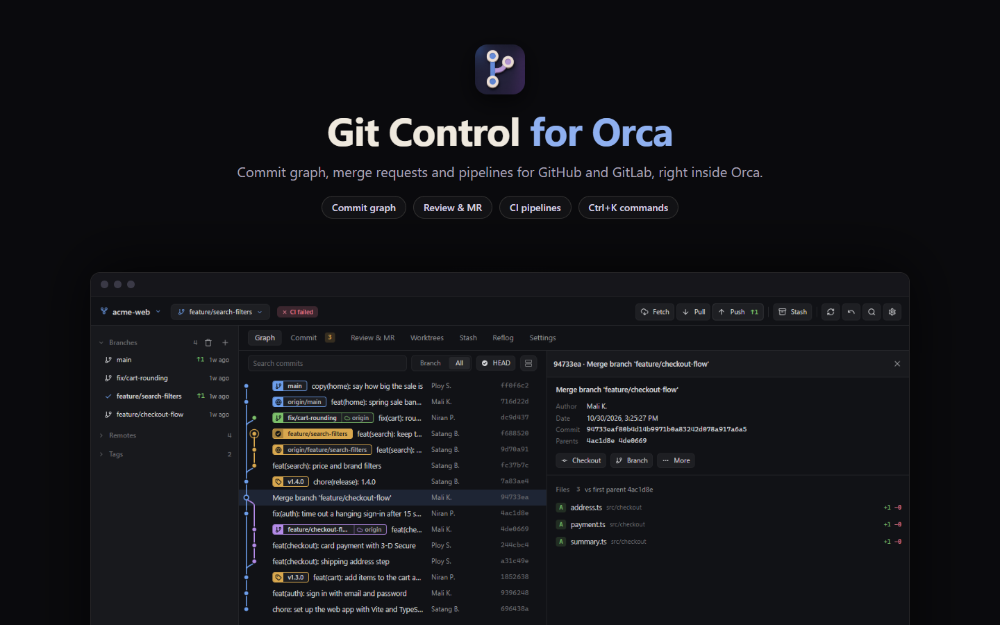
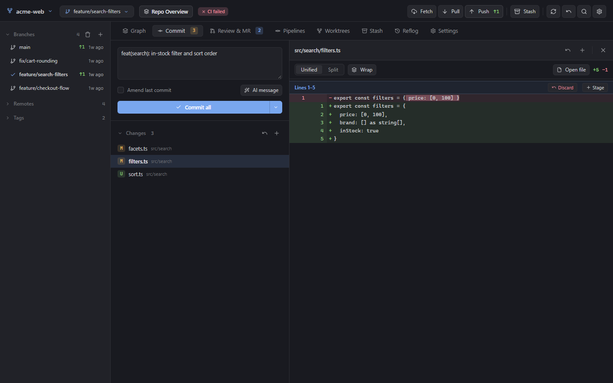
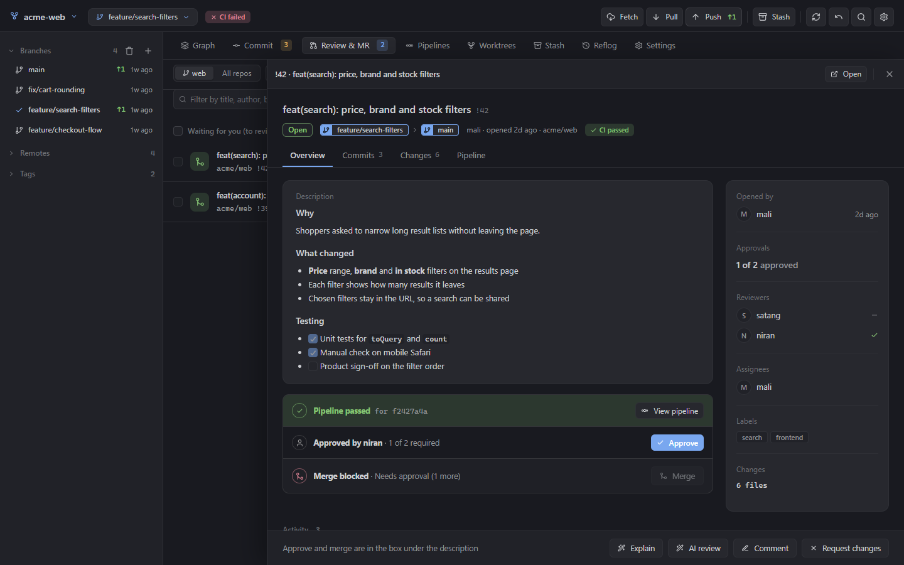
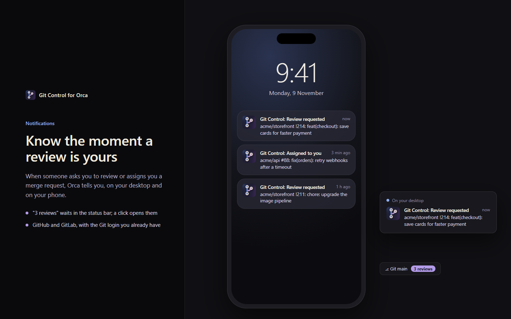
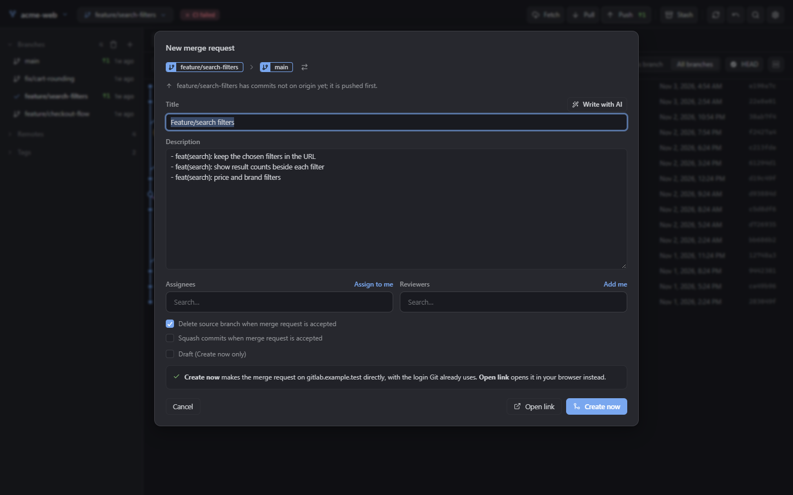
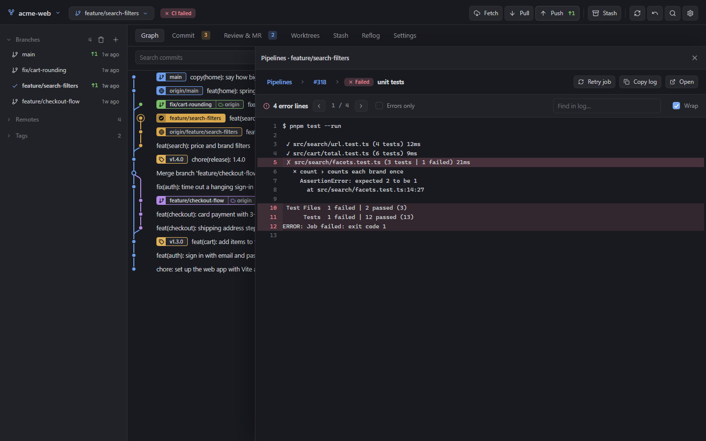
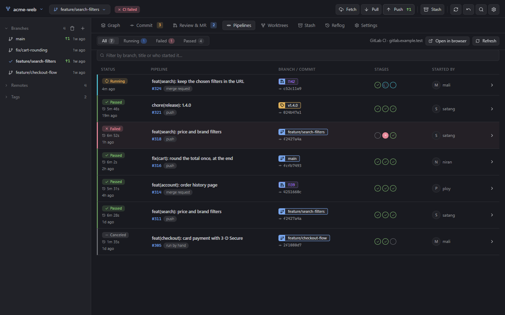
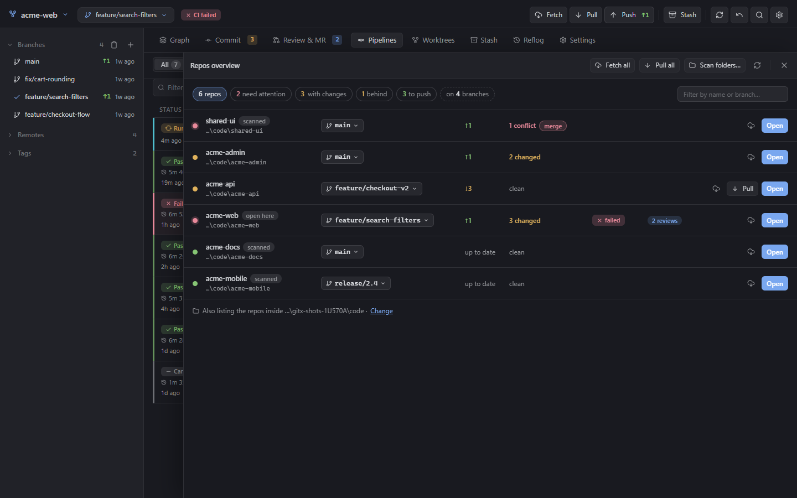

# Git Control for Orca

A Git client inside Orca: the commit graph, commits, branches, stashes, merge requests and pipelines for
GitHub and GitLab, in one editor tab and a sidebar panel. It runs your installed `git` and signs in with
the Git login you already have (or `gh` / `glab` when they are set up), so there are no tokens to create.



## Get started

1. Install **Git Control** from Orca's plugin marketplace (Settings → Plugins), or from this repository's Git URL.
2. Open a project that is a Git repository.
3. Click **Git** in the status bar (or run **Git: Open Git Control**) for the full tab, or open the
   **Git Control** panel (layers icon) in the right sidebar.

Requires Orca 1.4.248 or later and `git` on your PATH.

## What you can do

### See the history
The graph shows every branch with its own colour; the same colour marks that branch's labels. Click a
commit and its details open beside the graph, so you can step through commits with ↑ ↓ while the list
stays in view. Search finds messages, authors, changed files, hashes, branches and tags as you type.
Right-click any commit for checkout, branch, tag, merge, rebase, cherry-pick, revert, reset and more.
Drag a branch onto the one you are on to merge it, onto another to rebase, or onto Remotes to push.
**Explain** asks AI what a commit (or a merge request) changes and why, in plain words. A file's page shows
its whole history with each change, and who wrote each line (newer lines are warmer).

### Commit
The Commit tab lists your changes on the left and the selected file's diff on the right. Stage whole
files or single hunks, write the message (or let **AI message** draft it), and commit. When nothing is
left to commit but commits wait on your machine, the same button becomes **Push**. Before committing,
Git Control takes a second look: a secrets file, a token or key being added, a very big file, or a commit
straight to a shared main branch is pointed out first. **Ctrl+Z** undoes the last action.



### Review merge requests
**Review & MR** has three tabs: **To review** (asked to review or assigned to you), **Opened by me** and **All** (open ones first, then merged ones by day: Today, Last 7 days, then by month, with **Show more merged** at the end for older ones);
the count is what still waits for your approval, and it shows as soon as a project opens. Search, filter by project
or label, and see new comments since you last looked. Approve or merge right from the list, or tick several and **Approve & merge** them together:
they merge in the background while you keep working. Within one project they go one at a time, each waiting
until the one before is merged and rebasing when GitLab asks, so they never collide; other projects go at the
same time, and you are told as each one merges. An approved one stays, marked **Approved · waiting merge**; one with conflicts is marked
**Conflicts**; while its pipeline runs the button reads **Merge when CI passes**. Only a real merge removes it.

Click one to read it like on GitHub or GitLab: the description, reviewers and approvals, the activity with inline
comments, its commits and changes. Under the description sits the merge box, laid out like GitLab's: the
pipeline, the approvals with **Approve** on the right (or **Revoke**), then **Merge now** with *Delete source
branch* and *Squash commits* (or **Merge when pipeline passes**), or the reason it cannot be merged yet.
**Explain**, **AI review**, **Comment** and **Request changes** are at the bottom.



When someone asks you to review or assigns you a merge request, Orca shows a notification, on your desktop and
on your phone through Orca's app, and **3 reviews** waits in the status bar until you open them.



### Open a merge request
Right-click a branch → **Merge request** and pick the direction (written source → target). The title and
description are filled in the way GitLab does it, assignees and reviewers come from the project, and
**Create now** makes it with your Git login, pushing the branch first when needed.



### Merge and resolve conflicts
Right-click any branch or tag label in the graph (or a tag in the sidebar): the first item merges that one into
your branch. If both sides changed the same lines, the conflicts page names them, **Incoming (their branch)** and
**Current (your branch)**, and lets you keep one side for all files at once, let **AI resolve all** (or one file),
or go file by file, conflict by conflict, side by side, with the result editable. Then **Commit merge**.
Parts where only one side really changed (or both made the same change) are counted for you: **Apply
non-conflicting** merges them in one click, and **Show base** shows the file as it was before either side changed it.

### Rewrite history safely
**Interactive rebase** (right-click a commit → More): drag commits to reorder; keep, reword (type the new message in
place), squash, fixup or drop each one; a line says what the branch will look like before you start. **Reset**
explains each kind (keep staged, keep unstaged, keep only your work, throw away) and how to get commits back.
**Ctrl+. → Show git commands** lists the exact git commands that ran, and can show them with each action.

### Fix a failing pipeline
The **CI** badge next to the branch shows the latest pipeline. Click it to see the jobs by stage, open
the failed one and step straight through its error lines. Retry a job, the failed jobs or the whole
pipeline without leaving Orca. Works with GitHub Actions and GitLab CI.



### Every pipeline on one page
The **Pipelines** tab lists the latest runs of every branch, laid out like GitLab's: the status with how long it
took, the commit's message, what started it (push, merge request, schedule, by hand), the branch, tag or merge
request (as !142), each stage as a dot, and who ran it. Filter by running, failed or passed, or by text; it
updates by itself while runs go on, and a click opens the run's jobs and logs.



### All your repos on one page
Working in several repos at once? **All repos overview** (top of the repository picker, or **Ctrl+.**) lists each
one with its branch, how far it is ahead or behind, its changes, CI and the reviews waiting for you. The ones that
need you come first, and the summary on top (*3 with changes*, *1 behind*, *on 4 branches*) filters the list.
**Fetch all** fetches every repo; **Pull all** pulls only where it is safe (no local changes, nothing unpushed) and
says why it skipped the rest. Each row can fetch, pull, switch branch or open that repo. It lists the repos
opened in Orca; **Scan folders…** adds the repos inside any folder too. (Idea from
[Multi-Repo Git Overview](https://github.com/gino8080/orca-git-overview) by gino8080.)



### Work by keyboard
**Ctrl+.** opens every command by name (fetch, pull, push, stash, new branch, any tab). In the graph,
↑ ↓ (or j k) move, Enter opens, / searches and Esc closes. **Ctrl+Z** undoes the last action.

### And also
- **Fetch, Pull, Push** show how many commits wait (↑ green to push, ↓ amber to pull, red when the branch
  and its remote have gone separate ways), animate while they run and say what changed
- **Branches, tags and remotes** in the sidebar; **Worktrees**, **Stash** and **Reflog** tabs
- **Undo** takes back the last commit, reset, merge or rebase
- **Settings**: git config for the repository or globally, and name/email profiles you can switch
- Comes back to the tab, scroll position and open commit you left in each project
- Follows Orca's light and dark themes; works in the narrow sidebar and on phones through Orca's web client

AI features use the Claude Code or Codex CLI you have installed (Settings → Plugins → Git Control).

## Privacy

Git Control runs `git`, and `gh` / `glab` when present, on your machine. It talks only to your own
GitHub or GitLab hosts, with the login Git already uses; the token is never shown, logged or sent
anywhere else.

Merge request descriptions, comments and AI answers are treated as untrusted: their Markdown becomes
text and plain `https` links, never markup of its own. The files Git Control writes in a working tree
(`Git.control`, `.gitignore`) are never written through a symlink a repository commits.

## Development

```sh
orca plugin validate .
orca plugin dev reload .     # loads into Orca; asks you to approve on first load
node tools/build.mjs         # after editing panel/: builds panel/graph.html (tab) and panel/sidebar.html (panel)
```

Tests run against throwaway repositories and a fake GitHub/GitLab API, never your accounts or config
(`cd tests && npm install` first; they need Google Chrome):

```sh
node e2e.mjs <plugin folder> <shots folder>       # the full tab, clicked through like a person
node mobile.mjs <plugin folder> <shots folder>    # phone size, loaded the way Orca's web client loads it
node sidebar.mjs <plugin folder> <shots folder>   # the right-sidebar panel at several widths
node worker-api.mjs github|gitlab                 # merge requests, reviews and CI through the Git login
node merge-queue.mjs                              # Approve & merge on several: one at a time per project
node statusbar.mjs                                # the Git status bar item never disappears
node screenshots.mjs <plugin folder> <out folder> # the screenshots above, on a made-up project
node promo.mjs <plugin folder>                    # marketplace posters from assets/screenshots → assets/promo
```

```
orca-plugin.json   manifest (trusted-worker: the worker runs git)
worker/main.mjs    git, GitHub and GitLab operations, exposed to the panel
panel/             tab.html (editor tab), index.html (sidebar panel), style.css, app.js
tools/build.mjs    packs each page into one self-contained file
```
